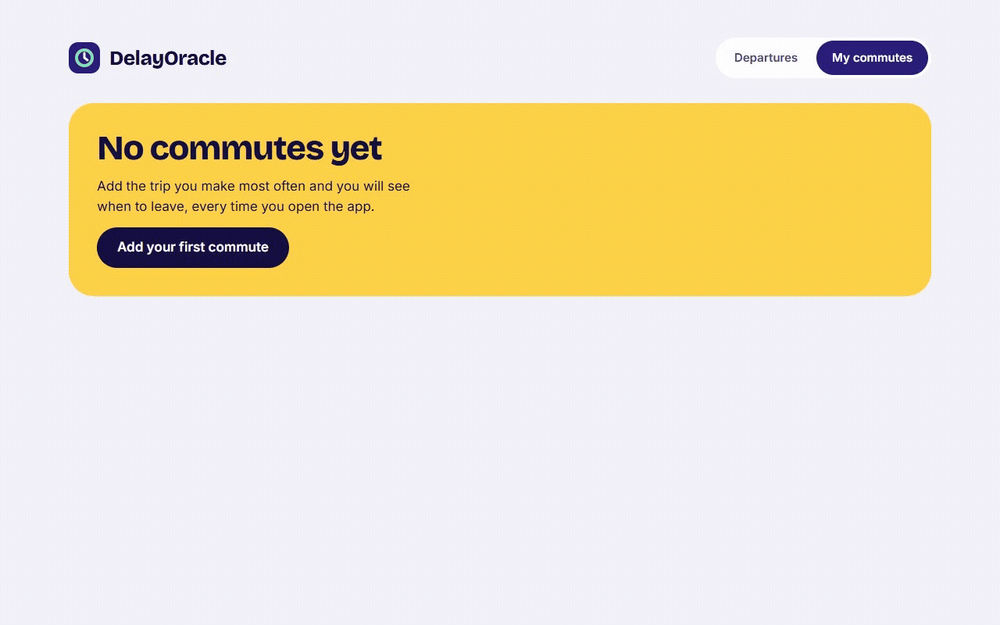

# DelayOracle

**Język:** Polski · [English](README.en.md)



**Demo:** to samo nagranie w lepszej jakości jest w pliku [docs/walkthrough.mp4](docs/walkthrough.mp4) (63 s).

DelayOracle podpowiada, kiedy wyjść z domu, żeby zdążyć na komunikację miejską w Gdańsku. Łączy odjazdy na żywo z ZTM Gdańsk, prognozę opóźnienia z wytrenowanego modelu oraz czas dojścia na przystanek.

**Stan projektu:** aplikacja jest ukończona i działa lokalnie. Nie jest nigdzie hostowana: wdrożenie zostało odłożone, ponieważ projekt nie ma na razie zasobów na hosting.

## 1. Aplikacja i jej funkcjonalności

Aplikacja ma dwie zakładki (interfejs jest po angielsku).

- **Departures (odjazdy):** wyszukiwanie przystanku i jego odjazdy na żywo. Każdy odjazd pokazuje czas rozkładowy, czas prognozowany, opóźnienie opisane słowami oraz źródło prognozy (model, opóźnienie podawane na żywo przez ZTM albo sam rozkład). Osobna karta pokazuje zmierzony błąd modelu obok wyniku bazowego.
- **My commutes (moje dojazdy):** zapisanie trasy (przystanek, opcjonalnie linia, czas dojścia) i odpowiedź, kiedy wyjść, na przykład „Leave in 6 minutes”. Odpowiedź odświeża się co 30 sekund. Dojazdy można edytować i usuwać.

Co jeszcze warto wiedzieć:

- **Osobista lista bez logowania.** Przeglądarka pamięta dojazdy, które w niej utworzono. Przycisk „Copy link” tworzy link, który dodaje te same dojazdy na innym urządzeniu. Oba urządzenia współdzielą wtedy te dojazdy, więc edycja lub usunięcie na jednym jest widoczne na drugim.
- **Każdy ekran ma stan ładowania, stan pusty i stan błędu.** Układ działa od szerokości 360 px, i dopasowuje się do jasnego lub ciemnego motywu systemu. Elementy sterujące to prawdziwe przyciski i pola z etykietami, z widocznym obramowaniem fokusu.
- **Aplikacja działa także bez modelu.** Gdy usługa prognoz nie jest uruchomiona, aplikacja pokazuje opóźnienie podawane przez ZTM i wyraźnie to zaznacza.

## 2. Opis techniczny

### Użyte technologie

| Część | Folder | Technologie |
|---|---|---|
| API | `backend/` | C#, ASP.NET Core (.NET 10), EF Core, SQLite, xUnit |
| Usługa prognoz (worker) | `ai-worker/` | Python 3.14, FastAPI, PyTorch, pytest, ruff |
| Aplikacja webowa | `frontend/` | React, TypeScript, Vite, TanStack Query, Vitest |
| Narzędzia | | Docker Compose, GitHub Actions (build, testy i lint przy każdym pull requeście) |
| Dane | | otwarte dane ZTM Gdańsk (CC BY) |

Frontend rozmawia wyłącznie z API. API pobiera przystanki i odjazdy z ZTM, a prognozy z workera. Pełny projekt opisuje [docs/ARCHITECTURE.md](docs/ARCHITECTURE.md) (po angielsku).

### Ciekawsze rozwiązania

- **Wytrenowany model i uczciwe porównanie.** Mała sieć w PyTorch przewiduje, o ile zmieni się opóźnienie pojazdu do chwili odjazdu. Jest zawsze porównywana z wynikiem bazowym „opóźnienie końcowe równa się obecnemu”, czyli z tym, co pokazuje ZTM. Dane są dzielone według czasu, nigdy losowo, a ograniczenia są spisane (zob. [Model prognozy](#5-model-prognozy)).
- **Tryb awaryjny zamiast błędu.** Jeśli worker nie odpowie w wyznaczonym czasie, API zwraca opóźnienie z ZTM i oznacza odjazd jako `source: "fallback"`. Jeśli nie działa samo ZTM, API odpowiada kodem 503 z treścią ProblemDetails, a aplikacja pokazuje kafelek błędu z przyciskiem ponowienia.
- **Dojazdy bez kont.** Identyfikator dojazdu to losowy GUID i jest jedynym kluczem do niego. API nigdy nie zwraca dojazdów, o które nie zapytano po identyfikatorze. Przeglądarka trzyma swoje identyfikatory w `localStorage`, a link do udostępniania przenosi je we fragmencie adresu (po znaku `#`), którego przeglądarki nie wysyłają do serwera. To nie jest uwierzytelnianie: każdy, kto dostanie identyfikator, może odczytać, zmienić i usunąć ten dojazd.
- **Reguła „kiedy wyjść” jako czysta funkcja.** `AdviceCalculator` przyjmuje odjazdy, czas dojścia i bieżący czas, nie wykonuje żadnych operacji wejścia/wyjścia i jest testowany jednostkowo. Zegar jest wstrzykiwany (`TimeProvider`), więc testy endpointów działają w ustalonym momencie.
- **Jedno miejsce buduje dane wejściowe modelu.** Plik `features.py` workera jest używany i przy trenowaniu, i przy serwowaniu prognoz, więc te dwa etapy nie mogą się rozjechać.
- **Testy na każdej warstwie.** API jest testowane przez HTTP z bazą SQLite w pamięci oraz z atrapami ZTM i workera. Każdy komponent i każda strona frontendu są testowane z podstawionym `fetch`, łącznie ze stanami ładowania, pustym i błędu.

## 3. Uruchomienie lokalne krok po kroku

Polecenia są dla PowerShella i wykonuje się je z katalogu głównego repozytorium. Kroki 2–4 uruchom w osobnych terminalach i zostaw je włączone.

### Wymagania

- .NET 10 SDK
- Node.js 24
- Python 3.14 (tylko dla usługi prognoz)
- dostęp sieciowy do otwartych danych ZTM Gdańsk

### Krok 1: pobierz kod

```powershell
git clone https://github.com/ArseniMokhau/DelayOracle.git
cd DelayOracle
```

### Krok 2: uruchom API

```powershell
dotnet run --project backend/DelayOracle.Api --urls http://localhost:5000
```

Przy pierwszym uruchomieniu API samo tworzy bazę SQLite. Jest gotowe, gdy odpowiada to zapytanie:

```powershell
Invoke-RestMethod http://localhost:5000/api/health
```

Swagger UI jest pod adresem http://localhost:5000/swagger.

### Krok 3: uruchom usługę prognoz (opcjonalnie)

Bez workera aplikacja nadal działa i pokazuje opóźnienie z ZTM. Z workerem odjazdy są oznaczone jako „Model”.

```powershell
cd ai-worker
python -m venv .venv
.venv\Scripts\Activate.ps1
pip install -r requirements.txt
uvicorn app:app --port 8000
```

### Krok 4: uruchom frontend

```powershell
cd frontend
npm ci
npm run dev
```

### Krok 5: otwórz aplikację

Wejdź na http://localhost:5173. W zakładce **Departures** wpisz nazwę przystanku, na przykład „brama”, i wybierz przystanek. W zakładce **My commutes** dodaj pierwszy dojazd.

Aby skierować frontend na inny adres API, skopiuj `frontend/.env.example` do `frontend/.env.local` i zmień `VITE_API_URL`.

### Alternatywa: wszystko w Dockerze

Przy włączonym Docker Desktop jedno polecenie uruchamia wszystkie trzy części pod tymi samymi adresami:

```powershell
docker compose up --build
```

### Testy i kontrola jakości

| Część | Polecenia |
|---|---|
| API | `dotnet build backend/DelayOracle.slnx -warnaserror`, `dotnet test backend/DelayOracle.slnx` |
| Worker (w `ai-worker/`, z aktywnym venv) | `ruff check .`, `pytest` |
| Frontend (w `frontend/`) | `npm run lint`, `npm test -- --run`, `npm run build` |

Te same kontrole uruchamia GitHub Actions przy każdym pull requeście (`.github/workflows/ci.yml`).

### Ręczne sprawdzenie API

```powershell
# Znajdź przystanek, potem zobacz jego odjazdy na żywo
Invoke-RestMethod "http://localhost:5000/api/stops?query=brama wyz"
Invoke-RestMethod http://localhost:5000/api/stops/1028/departures

# Zapisz dojazd, potem zapytaj, kiedy wyjść
$commute = Invoke-RestMethod http://localhost:5000/api/commutes -Method Post -ContentType "application/json" `
  -Body '{"name":"Home to work","stopId":1028,"walkMinutes":5}'
Invoke-RestMethod "http://localhost:5000/api/commutes/$($commute.id)/advice"

# Zmierzony błąd modelu
Invoke-RestMethod http://localhost:5000/api/model
```

Po zmianie encji wygeneruj migrację (wcześniej raz uruchom `dotnet tool restore`):

```powershell
dotnet ef migrations add <Nazwa> --project backend/DelayOracle.Api --output-dir Data/Migrations
```

## 4. Jak korzystałem z narzędzi AI

Kod aplikacji napisałem sam. Narzędzia AI wspierały pracę wokół niego:

- **Claude (czat)** pomógł na początku: przy sprawdzeniu, czy dla tego pomysłu istnieją darmowe, prawdziwe dane, oraz przy jednorazowych prototypach weryfikujących źródło danych i wybrane technologie.
- **Claude Code** pracował w repozytorium według reguł projektu zapisanych w `AGENTS.md` i `CLAUDE.md` oraz poleceń w `.claude/commands/` (`/verify`, `/commit`, `/review`, `/milestone-done`). Użyłem go do:
  - przygotowania szkieletu: trzech projektów, plików Dockerfile, Docker Compose i workflow CI;
  - pisania testów dla każdego kroku;
  - przygotowania makiet HTML i arkuszy CSS wybranego wyglądu;
  - szkiców dokumentacji i dzielenia zmian na commity.

Część rzeczy trzeba było poprawić, na przykład:

- Pierwsza wersja modelu miała sześć cech, w tym dzień tygodnia i pogodę. Sprawdzenie na danych spoza dwóch zebranych dni pokazało błędne prognozy, więc model został ograniczony do trzech cech.
- Testy napisane przez AI nie wykryły, że znacznik czasu tracił oznaczenie UTC po odczycie z SQLite. Doszedł test na surowym JSON-ie i błąd został naprawiony.
- Pierwszy projekt frontendu zakładał, że dojazdy są wspólne dla wszystkich odwiedzających. Zastąpiła go osobista lista z linkiem do udostępniania.

Pełny zapis, etap po etapie, jest w [docs/AI_USAGE.md](docs/AI_USAGE.md) (po angielsku).

## 5. Model prognozy

Model przewiduje, o ile zmieni się opóźnienie pojazdu między chwilą obecną a jego odjazdem. To mała sieć w PyTorch, trenowana skryptem `ai-worker/train.py` na prawdziwych odjazdach zebranych z ZTM Gdańsk. Ma trzy cechy wejściowe: obecne opóźnienie, liczbę minut do odjazdu i lokalną godzinę. Poniższe liczby pochodzą z pliku `ai-worker/models/model_card.json`, który zapisuje `train.py`.

| | |
|---|---|
| Dane | 28 110 odjazdów z 250 przystanków, od piątku 13 listopada 2026, 09:30, do soboty 14 listopada 2026, 14:25 (czas lokalny) |
| Podział według czasu | pierwsze 80% to zbiór treningowy (22 488 wierszy), ostatnie 20% to zbiór testowy (5 622 wiersze, sobota 08:42–14:25) |
| Wynik bazowy | „opóźnienie końcowe równa się obecnemu”, czyli to, co pokazuje ZTM |
| Średni błąd bezwzględny na zbiorze testowym | model 113,0 s, wynik bazowy 159,2 s |
| To samo dla odjazdów bliższych niż 10 minut (122 wiersze testowe) | model 77,3 s, wynik bazowy 90,7 s |

Aby odtworzyć wynik: `cd ai-worker`, potem `python train.py` (około 10 sekund, bez dostępu do sieci).

Pełne omówienie danych, modelu, treningu, workera i integracji z API, wraz ze słowniczkiem, jest w [docs/PREDICTION_MODEL.pdf](docs/PREDICTION_MODEL.pdf) (po angielsku).

### Ograniczenia

- **Dwa dni danych.** Model widział jeden piątek i część jednej soboty. Nie wie nic o innych dniach tygodnia, o godzinach szczytu w zwykłym tygodniu pracy, o świętach ani o innych porach roku, a testowany był na jednym sobotnim poranku. Powyższy wynik opisuje te godziny, a nie system w ogóle.
- **Bez dnia tygodnia i bez pogody.** Obie cechy były planowane, razem z klientem pogody w API (Open-Meteo). Zostały pominięte w obecnej wersji z braku czasu: dwa dni to dwa dni tygodnia i temperatury od 4,3 do 7,9 °C przy 0,6 mm deszczu. Model trenowany z tymi cechami wypadł gorzej (119,0 s) i dawał błędne prognozy dla innych dni tygodnia i temperatur, na przykład ponad 20 minut opóźnienia przy 20 °C.
- **Cechy wybrano przy użyciu zbioru testowego.** Model z trzema cechami został wybrany po porównaniu wersji na tych samych wierszach testowych, więc jego 113,0 s jest nieco zbyt optymistyczne.
- **Mało bliskich odjazdów.** Kolektor zapisywał tylko pierwszą i ostatnią obserwację każdego odjazdu, a pierwsza przypada zwykle około 28 minut przed odjazdem. Wynik dla odjazdów bliższych niż 10 minut opiera się na 122 wierszach testowych i należy go czytać jako „nie gorzej niż ZTM”, a nie jako udowodniony zysk.
- **Jeden rodzaj modelu.** Sieć nie była porównywana z innymi rodzajami modeli, tylko z wynikiem bazowym.

## 6. Odłożone na później

- **Wdrożenie.** Hosting API i workera wymaga zasobów, których projekt na razie nie ma (sam obraz Dockera workera ma około 1,6 GB). Aplikacja jest na to przygotowana: adres API i dozwolone źródła CORS są w konfiguracji, a każda część ma swój Dockerfile.
- **Dłuższe zbieranie danych i ponowny trening.** Kolektor zapisuje teraz każdą obserwację odjazdu (tabela `sightings`), więc opóźnienie da się śledzić aż do ostatnich minut. Trening na kilku tygodniach danych pozwoli ponownie sprawdzić bliskie odjazdy.
- **Dzień tygodnia i pogoda jako cechy,** razem z klientem pogody w API, gdy zebrane dane obejmą pełne tygodnie i różną pogodę.

## Źródła danych

- Dane czasu rzeczywistego: portal otwartych danych ZTM Gdańsk (CC BY).
