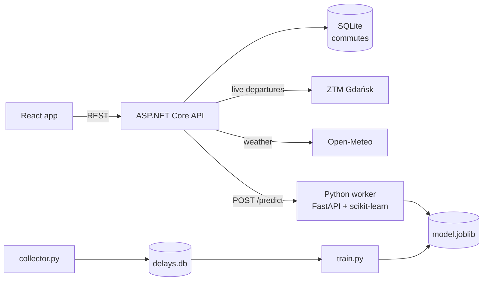

# DelayOracle: architecture

## Overview

DelayOracle tells a user when to leave home to catch a public transport vehicle in Gdańsk. It combines live departures from ZTM Gdańsk, a delay prediction from a machine-learning model, and the user's walking time to the stop.

## Components



| Component | Responsibility |
|---|---|
| Frontend | User interface; talks only to the API |
| API | REST endpoints, validation, persistence; calls ZTM, Open-Meteo and the worker |
| Worker | Serves delay predictions from the trained model |
| `collector.py`, `train.py` | Offline: collect delay data, train and evaluate the model |

## Technology

| Part | Technology |
|---|---|
| Backend | C#, ASP.NET Core (current .NET LTS), EF Core, SQLite, xUnit |
| Worker | Python 3.14, FastAPI, pandas, scikit-learn, pytest |
| Frontend | React, TypeScript, Vite, TanStack Query |
| Tooling | Docker Compose, GitHub Actions, GitHub Pages |
| Data | ZTM Gdańsk open data (CC BY), Open-Meteo |

## Repository layout

```
delayoracle/
├── AGENTS.md  CLAUDE.md  README.md  docker-compose.yml
├── .claude/commands/
├── .github/workflows/
├── docs/                 ARCHITECTURE.md, AI_USAGE.md, media/
├── backend/
│   ├── DelayOracle.slnx
│   ├── DelayOracle.Api/  Controllers/, Services/, Models/, Data/, Program.cs
│   └── DelayOracle.Tests/
├── ai-worker/            collector.py, features.py, train.py, app.py, tests/, models/, data/sample/
└── frontend/src/         api/, components/, pages/, App.tsx
```

## API

Base path `/api`. JSON is camelCase. Errors are ProblemDetails.

| Method and path | Purpose | Success | Errors |
|---|---|---|---|
| `GET /stops?query=` | Search stops by name (at most 20 results) | 200 | 400 |
| `GET /stops/{stopId}/departures` | Live departures with a predicted delay | 200 | 503 |
| `GET /commutes` | List commutes | 200 | |
| `POST /commutes` | Create a commute | 201 + `Location` | 400 |
| `GET /commutes/{id}` | Read a commute | 200 | 404 |
| `PUT /commutes/{id}` | Replace a commute | 200 | 400, 404 |
| `DELETE /commutes/{id}` | Delete a commute | 204 | 404 |
| `GET /commutes/{id}/advice` | When to leave | 200 | 404, 503 |
| `GET /model` | Model card from the worker | 200 | 503 |
| `GET /health` | Liveness | 200 | |

A departure contains `route`, `headsign`, `scheduledTime`, `estimatedTime`, `currentDelaySeconds`, `predictedDelaySeconds`, `predictedTime` and `source`. The source is `model`, `fallback` (worker unavailable, ZTM's own delay used) or `schedule` (no live data).

Departures request flow: the API fetches departures from ZTM, fetches current weather (cached about 10 minutes), sends both to the worker in one batch, and merges the predicted delays into the response.

Failure behaviour: worker unavailable gives a normal response with `source: "fallback"`; ZTM unavailable gives 503; invalid input gives 400 with field errors; unexpected errors give a 500 ProblemDetails without a stack trace.

There is no authentication. Commutes are shared by all visitors.

## Data model

`Commute`: `Id`, `Name` (required, at most 60 characters), `StopId` (required, positive), `RouteShortName` (optional, at most 8 characters), `WalkMinutes` (0 to 60), `CreatedAt` (UTC).

The stop list is loaded from ZTM once and kept in memory.

## Advice rule

For each departure with a `predictedTime`:

```
leaveBy = predictedTime - walkMinutes - 1 minute
```

The answer comes from the earliest departure whose `leaveBy` is not in the past. `leaveInMinutes` is the whole minutes from now to `leaveBy`; zero means leave now. If no departure qualifies, or there are none, the result is `NoDeparture`. The calculator sorts its input itself.

Examples (now 07:00, walk 5 minutes, so `leaveBy` is `predictedTime` minus 6 minutes):

| Predicted departures | Result |
|---|---|
| 07:12 | leave in 6 minutes |
| 07:06 | leave now |
| 07:04 and 07:20 | leave in 14 minutes |
| 07:03 | `NoDeparture` |
| none | `NoDeparture` |

## Prediction model

- **Data:** real ZTM departures collected by `collector.py`, one row per departure.
- **Label:** `last_delay_s`, the delay at the last sighting before departure.
- **Features:** `current_delay_s`, `minutes_to_departure`, `hour`, `weekday`, `precip_mm`, `temp_c`. Hour and weekday are Europe/Warsaw local time in training and serving.
- **Model:** `GradientBoostingRegressor`.
- **Baseline:** final delay equals current delay.
- **Split:** first 80% of the time range trains, last 20% tests.
- **Output:** model and baseline MAE on the test block, in `models/model_card.json`.

Worker endpoints: `POST /predict`, `GET /model`, `GET /health`. The worker makes no outside calls; the API supplies the weather.

```json
{ "items": [ { "current_delay_s": 240, "minutes_to_departure": 12.5,
               "hour": 8, "weekday": 4, "precip_mm": 0.4, "temp_c": 3.1 } ] }
```

```json
{ "model_version": "2026-11-15T10:12:00Z", "predictions": [ { "delay_s": 275 } ] }
```

Limitations: the training window is short (one to two days), so weekly patterns are not learned and weather varies little. The model may not beat the baseline; the model card and README report the measured result either way.

## Frontend

Two tabs.

- **Departures:** stop search; live departures with scheduled time, predicted time, a delay badge (text, not colour alone) and the prediction source; a card with the model and baseline MAE.
- **My commutes:** a list of commutes, each with its live answer from `/advice` (refreshed every 30 seconds); a form to create and edit with the validation rules above; delete with confirmation.

Every view has loading, empty and error states. All requests go through `src/api/`; the API address comes from `VITE_API_URL`.

## Testing

- Backend unit: `AdviceCalculator`; the worker-unavailable fallback.
- Backend integration: commutes endpoints through HTTP with in-memory SQLite.
- Worker: feature building; `/predict` response shape.
- Frontend: form validation (Vitest).

## Deployment

- CI (`ci.yml`): backend build and test, worker lint and test, frontend lint, test and build.
- Frontend: built and published to GitHub Pages (`deploy-pages.yml`).
- API and worker: Docker images, hosted on a free container host chosen at deployment time.
- Local: `docker compose up --build`.

## Milestones

1. **Skeleton:** solution, Vite app, worker folder, compose, CI. Done when each part starts with one command and CI is green.
2. **Commutes API:** endpoints, validation, migration, tests. Done when the status codes in the table are verified by tests.
3. **Advice rule:** `AdviceCalculator` with unit tests. Done when every example above passes.
4. **Live departures:** ZTM client, stop search, departures with fallback, `/advice`. Done when a real stop returns departures.
5. **Prediction worker:** features, training, baseline comparison, serving, API integration. Done when `train.py` prints model and baseline MAE and the API returns `source: "model"`.
6. **Frontend:** both tabs against the local API. Done when all states work and the app is usable at 360 px.
7. **Deployment and documentation:** Pages, API host, README, demo recording, AI usage log.
8. **Optional, asynchronous retraining:** `POST /api/model/retrain` returns 202; a `Channel<T>` with a `BackgroundService` calls the worker.

## Attribution

- Real-time data: ZTM Gdańsk open data portal (CC BY).
- Weather: Open-Meteo (see its terms for the required attribution).
